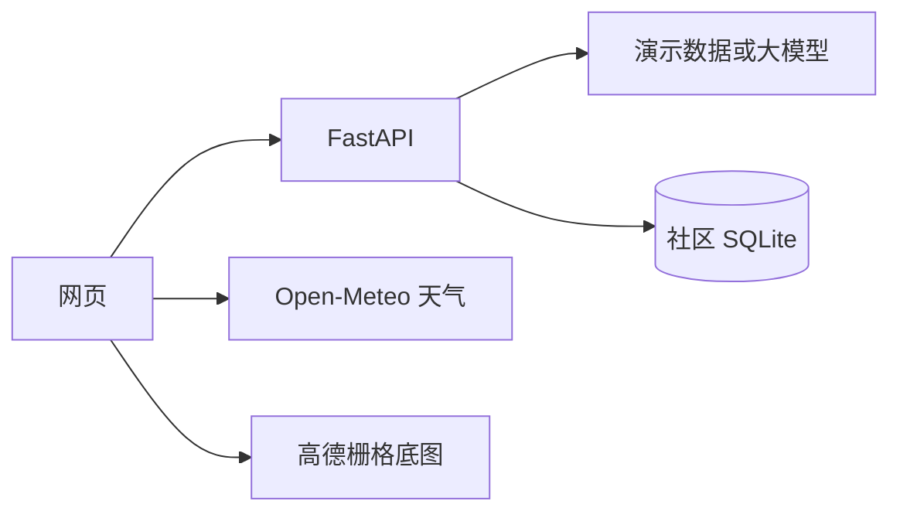

<h1 align="center">途灵 TripGenie</h1>

<p align="center">
  给国内城市短途用的行程攻略。<br>
  在手机宽度的页面里排出几天怎么走、在哪吃、住哪，再按天读完。
</p>

<p align="center">
  
  
  
  
</p>

途灵把一次短途拆成能对照的几套走法，而不是只丢出一段说明文字。网页是规划主界面，看起来像一部手机；地图只标当天先后顺序，不提供导航。没有大模型密钥时，内置演示数据也能把整条流程走完。

演示城市是 **杭州、成都、西安**。目标是一份能放进简历的项目，也是 4C 中国大学生计算机设计大赛「人工智能应用」赛道的参赛作品。

## 界面

底部四个页面：

| 页面 | 做什么 |
| --- | --- |
| 首页 | 看目的地和常见景点，开始生成，或自己排 |
| 攻略 | 保存过的行程，打开、删除 |
| 社区 | 看别人分享的安排，留言，导入到自己的攻略，或把自己的发出去 |
| 我的 | 昵称、常用城市、生成偏好、行前清单、收藏的景点 |

生成时一次给出三套，差别写在数量上，而不是换一套形容词：

| 风格 | 取舍 |
| --- | --- |
| 紧凑 | 一天多看几处 |
| 松弛 | 少换地方，每处停留更久 |
| 省钱 | 把门票压下去 |

自定义则按出发日的天气排好时间。一天里有早餐、上午、午餐、下午、晚餐、晚上；多天行程除了最后一天，会放当晚的酒店。景点留空，由你自己选。饭馆和酒店可以换，也可以改成「就在附近吃」或「这天不住」。

打开一套攻略时，先读当天的时间、地点、花费和下一程，底部再用地图按顺序标出来。

## 快速开始

需要两个终端。先起后端，再开网页。

### 1. 后端

```bash
cd server
python -m venv .venv
```

Windows：

```bash
.venv\Scripts\python.exe -m pip install -r requirements.txt
.venv\Scripts\python.exe -m uvicorn app.main:app --reload --host 127.0.0.1 --port 8000
```

macOS / Linux：

```bash
.venv/bin/pip install -r requirements.txt
.venv/bin/uvicorn app.main:app --reload --host 127.0.0.1 --port 8000
```

浏览器访问 `http://127.0.0.1:8000/health`，应看到：

```json
{"status":"ok","engine":"mock"}
```

`engine` 为 `mock` 表示当前没有可用的大模型密钥，行程由内置数据生成。

### 2. 网页

```bash
cd web
npm install
npm run dev
```

打开 `http://127.0.0.1:5173`。宽屏幕上页面会收成一条手机宽度的栏。`/api` 和 `/health` 会代理到本机 `8000` 端口。

### 3. 试一条

首页点「生成攻略」，城市选杭州，3 天，2 人，预算 1500，偏好留下美食和人文，一次生成三套。进任意一套，能看到景点和补上的饭馆、酒店。再点「分享到社区」，写一句说明发出去；回到社区可以留言，或把别人的安排导入到自己的攻略。

自己排的话，首页点「自己排」。选出发日期后，时间和三餐会按天气预报排好，景点再逐段挑选。

## 数据从哪来



- 生成：`POST /api/trip/generate`。没有密钥时走演示引擎；配了密钥会优先用 DeepSeek，其次智谱 GLM。
- 天气：浏览器直接请求 Open-Meteo，不需要密钥。取不到天气时，自定义行程仍按一般节奏排，并提示出发前再看预报。
- 地图：高德栅格瓦片，坐标按原样标注，只表示先后，不计算转弯。
- 社区：保存在运行后端的那台机器上，文件是 `server/data/community.sqlite`，不进版本库。昵称来自「我的」，存在这台浏览器里。连着同一个后端的人，能看到同一批分享。

环境变量都可以不设：

| 变量 | 作用 | 默认 |
| --- | --- | --- |
| `LLM_ENGINE` | `auto` / `deepseek` / `glm` / `mock` | `auto`，没有密钥就用演示数据 |
| `DEEPSEEK_API_KEY` | DeepSeek 密钥 | 空 |
| `GLM_API_KEY` | 智谱 GLM 密钥 | 空 |
| `COMMUNITY_DB` | 社区数据库路径 | `server/data/community.sqlite` |

密钥只放在环境变量里，不要写进仓库。

## 接口

### 生成行程

`POST /api/trip/generate`

```json
{
  "city": "杭州",
  "days": 3,
  "budget_total": 1500,
  "people": 2,
  "preferences": ["美食", "人文"],
  "style": "all"
}
```

`style` 可以是 `compact`、`relaxed`、`economy` 或 `all`。`all` 返回三套。`days` 在接口里是 1 到 7，网页上选 1 到 5。

响应是 `{ "engine", "plans", "warnings" }`。告警按风格加前缀，例如 `[relaxed] over_budget`。

### 社区

| 方法 | 路径 | 作用 |
| --- | --- | --- |
| `GET` | `/api/community` | 分享列表，可用 `?city=杭州` 筛选 |
| `GET` | `/api/community/{id}` | 一套分享的行程和留言 |
| `POST` | `/api/community` | 发布。正文含 `author`、`note`、`trip`，返回撤回用的 `token` |
| `POST` | `/api/community/{id}/comments` | 留言 |
| `POST` | `/api/community/{id}/remove` | 用发布时的 `token` 撤回 |

第一次打开社区时，库是空的会放入三套示例：杭州两天、成都市区一天、西安两天。

### 测试

```bash
cd server
.venv\Scripts\python.exe -m pytest -q
```

网页类型检查：

```bash
cd web
npx tsc --noEmit
```

## 目录

```text
途灵/
├── web/        规划网站。Vite + React + TypeScript
├── server/     FastAPI。生成、演示数据、社区
├── mobile/     Expo 骨架，用来在手机上看当天行程
└── docs/       执行计划
```

更细的定位、契约和里程碑写在 `docs/compose/spec/tuling-tripgenie.md`。

网页里和界面直接相关的部分：

| 路径 | 内容 |
| --- | --- |
| `web/src/screens/` | 首页、生成、自定义、攻略、社区、我的 |
| `web/src/data/places.ts` | 三座城市的景点、饭馆、酒店 |
| `web/src/custom/schedule.ts` | 按天气排时间、三餐和住宿 |
| `web/public/places/` | 景点图片 |
| `server/app/llm/mock_engine.py` | 无密钥时的演示行程 |
| `server/app/community/` | 社区的 SQLite 读写 |

## 移动端

移动端还是查看用的骨架，规划以网页为准。

```bash
cd mobile
npm install
npx expo start
```

接口地址在 `mobile/src/config/constants.ts`。安卓模拟器默认 `http://10.0.2.2:8000`。真机改成电脑的局域网地址，或用 `EXPO_PUBLIC_API_BASE` 覆盖。`EXPO_PUBLIC_USE_MOCK=1` 可以强制使用手机里的演示数据。

## 现在的边界

这些是当前版本的真实情况，避免把演示说成已经完成的排程系统：

- 没有密钥时，三套方案来自演示数据。费用会向预算靠拢，不是逐项真实报价。
- 自定义行程里的门票、餐费和房价是估计值，按人均或一间双床房计算。
- 地图不导航。点与点之间只给步行、公交或打车的粗算时间。
- 社区没有注册和登录。撤回凭据只留在发布的那台浏览器里。
- 收藏、昵称、攻略列表都在本机浏览器，换一台设备不会跟着走。
- 片区排程、账号体系和 iOS 还在计划里，不在这个仓库的当前界面中。

## 技术

| 部分 | 选型 |
| --- | --- |
| 网页 | Vite 6、React 19、TypeScript |
| 地图 | Leaflet，高德中文栅格瓦片 |
| 后端 | FastAPI、Pydantic v2 |
| 模型 | DeepSeek、智谱 GLM，否则使用演示引擎 |
| 社区存储 | SQLite |
| 天气 | Open-Meteo |
| 手机 | Expo |
