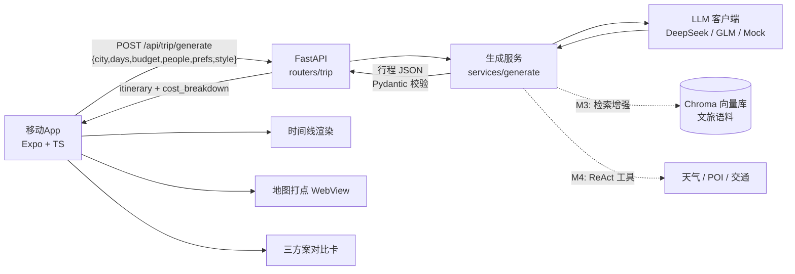
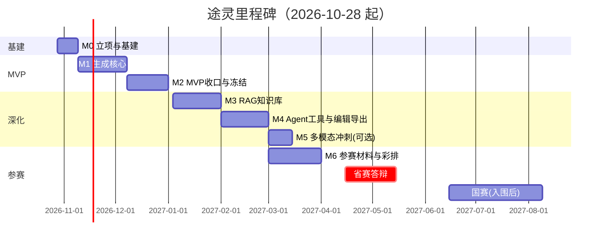

# 途灵 TripGenie · 项目执行计划（v2）

> 本文档在《旅游攻略AIApp_项目方案》（2026-10-28）基础上细化为**可执行计划**。
> 双目标：① 简历上的项目经历；② 4C 中国大学生计算机设计大赛「人工智能应用」赛道参赛作品。
> 已确认约束：独立开发，每周投入 ≥20 小时；2026-10-28 启动；2027 年省赛（4–5 月）。

## Report

## [S1] Problem

原方案书回答了「做什么、用什么技术」，但没有回答「按什么顺序做、什么时候必须停、做到什么程度算完成」。直接照原方案执行会掉进三个坑：

1. **贪多失控**：RAG + Agent + 多模态 + 编辑导出全部铺开，每样都半成品，省赛前凑不出可演示闭环。
2. **通用型平庸**：功能看着全，评委感受不到技术深度，沦为「大模型套壳」。
3. **演示翻车**：现场断网 / API 余额不足 / 大模型输出格式崩坏，直接出局。

本计划要交付的是：带**周排期、验收标准、机械砍线规则、成本核算、参赛材料规格**的执行方案，并按它落地 MVP 核心闭环（需求输入 → 结构化行程生成 → 多方案展示）。

## [S2] Design

### [S2.1] 总体策略

差异化不靠垂直人群，靠「技术深度 + 体验闭环 + 演示可靠性」三件事：

| 维度 | 平庸做法（避免） | 本项目做法 |
|---|---|---|
| 生成 | 需求直接丢给大模型出长文本 | JSON Mode 结构化输出 + Pydantic 契约校验 + 可编辑数据模型 |
| 数据 | 纯大模型「编」景点 | RAG 权威知识库溯源，每个推荐附来源（M3） |
| 实时性 | 静态文字 | Agent 调用天气 / POI / 交通，生成「当天可行」路线（M4） |
| 交互 | 纯文本 | 时间线 + 地图打点 + 三方案对比；多模态（M5 可选） |
| 演示 | 押注在线 API | **Mock 引擎常备**：无网 / 无 key 也能完整演示 |

第三行是本计划相对原方案书新增的硬要求：**Mock 模式不是测试工具，是演示保命通道**，与真实 LLM 走同一套契约。

### [S2.2] 关键技术决策（ADR）

| # | 决策点 | 选择 | 理由 | 备选 / 回退 |
|---|---|---|---|---|
| A1 | 跨端框架 | **Expo（prebuild / dev build）+ TypeScript** | Windows 开发起步快，能出 Android APK（参赛交付物）；iOS 需 Mac，不承诺 | 原方案的 bare RN CLI；若 prebuild 受阻则裸 RN |
| A2 | 地图 | **WebView + 高德 JS API** | 避开 RN 原生地图 SDK 在 Windows 上的构建泥潭；个人开发者可申请 | 天地图 JS API；最后兜底：静态地图图片打点 |
| A3 | 大模型 | **DeepSeek-V3（deepseek-chat，JSON 输出）** | 便宜、JSON 稳、OpenAI 兼容接口 | 智谱 GLM-4-Flash（免费额度）；两者都挂 → Mock 引擎 |
| A4 | 行程结构化 | **JSON Mode + Pydantic v2 校验 + 1 次修复重试** | 前端可渲染的前提是契约稳定；失败自动降级 Mock | Function Calling 备选；解析失败率 >10% 触发 prompt 重构 |
| A5 | RAG | **Chroma（内嵌）+ bge-m3 或智谱 embedding**（M3） | 零运维，学生项目体量够用 | Qdrant；语料不足时降级为固定来源引用 |
| A6 | Agent 编排 | **ReAct + Function Calling**（M4），工具：天气 / POI / 交通 | 4C AI 赛道核心加分点 | 不稳定则改为「生成时一次性预取工具结果注入 prompt」 |
| A7 | 后端 | **FastAPI + Pydantic**；状态生成无状态、不依赖 DB | MVP 阶段免 DB，降低部署与演示复杂度 | 用户 / 历史功能（P1）再引入 PostgreSQL |
| A8 | 部署 / 演示 | 开发期本机 uvicorn + 手机同局域网；演示期 **mock 模式 + 预录视频双保险** | 学生预算与稳定性优先 | 内网穿透（cpolar）或云学生机做远程 API |
| A9 | APK 构建 | 本机 Android SDK `gradlew assembleRelease` | 参赛必须交可运行包 | EAS Build 云构建（免费额度有限，备用） |

### [S2.3] 行程 JSON 契约（前后端唯一事实源）

后端 `server/app/schemas/trip.py`（Pydantic）与前端 `mobile/src/types/trip.ts`（TS interface）必须逐字段同步；契约变更需同步改两侧并跑双端校验。

```json
{
  "trip_id": "uuid4",
  "city": "杭州",
  "days": 3,
  "people": 3,
  "budget_total": 1500,
  "style": "compact | relaxed | economy",
  "preferences": ["亲子", "美食"],
  "summary": "一句话行程概述",
  "itinerary": [
    {
      "day": 1,
      "theme": "西湖经典线",
      "items": [
        {
          "time_start": "09:00",
          "time_end": "11:30",
          "type": "attraction | meal | transport | hotel | free",
          "title": "断桥残雪",
          "poi": { "name": "断桥残雪", "lat": 30.259, "lng": 120.147, "adcode": "330106" },
          "duration_min": 150,
          "cost_estimate": 0,
          "description": "景点介绍",
          "tips": "建议早去避人流",
          "transport_to_next": { "mode": "walk | transit | drive | taxi", "duration_min": 15, "note": "沿白堤步行" },
          "sources": [{ "title": "杭州市文化广电旅游局", "url": "https://..." }]
        }
      ]
    }
  ],
  "cost_breakdown": { "transport": 200, "food": 400, "tickets": 300, "hotel": 500, "other": 100 }
}
```

**校验规则**（Pydantic 自定义校验 + 服务层断言，全部有测试覆盖）：

- 每日 `items` 2–6 个；`time_start < time_end`；当日时段不重叠（容差 5 分钟）。
- `cost_breakdown` 各项之和与 `budget_total` 偏差 ≤20%，超差由服务层标注 `over_budget` 风险提示（不静默篡改）。
- `preferences` 中的标签至少 50% 在当日 `items` 的 `description/tips` 中有对应活动。
- `style=compact`：每日 ≥5 项且步行衔接占比高；`style=relaxed`：每日 ≤4 项、单点停留 ≥90 分钟；`style=economy`：门票类花费占比最低且明确标「免费/低价」备选。
- 生成失败（JSON 解析失败 / 校验不过）→ 修复重试 1 次 → 仍失败则返回 Mock 结果并在响应中标 `"engine": "mock"`，前端给出降级提示。

### [S2.4] 架构与数据流



MVP 阶段（M0–M2）E、F 两路虚线不存在，C 只依赖 D；M3/M4 是增量特性，各自另立 feature 文档（见 [S2.14]）。

### [S2.5] 功能分层（砍线的依据）

| 层 | 内容 | 冻结时间 | 不达标的处理 |
|---|---|---|---|
| **P0 必须**（参赛底线） | 需求输入（城市/天数/预算/人数/偏好标签/风格）；AI 生成多日行程（结构化）；行程时间线详情；三方案对比（紧凑/松弛/省钱）；地图打点连线；错误与降级提示；Android APK 可安装；后端 API 可独立运行 | 2026-12-31 | 直接砍到「单方案 + 静态图地图」，保生成闭环 |
| **P1 应该**（AI 赛道主加分） | RAG 检索 + 来源标注；天气 Agent；真实 POI 坐标/票价；行程编辑（拖拽/增删/备注）；导出图片/PDF；历史与收藏 | 2027-02-28 | 按 [S2.7] 规则降级，不阻塞参赛 |
| **P2 可以**（时间富余才做） | 拍照识景（视觉大模型）；语音输入/TTS 播报；偏好记忆；人流热力 | 2027-03-14 | 全部放弃不心疼，答辩里口头提及路线图即可 |
| **P3 不做** | 社区分享、多语言、商业化支付、iOS 上架 | — | 明确写进「暂不考虑」 |

**本次 Compose 交付范围（founding slice）**：P0 中的「输入 → 生成 → 多方案展示」核心闭环可运行（mock 引擎下全流程可演示），地图打点留接口与占位（真实地图属 M2 收口）。

### [S2.6] 里程碑与周排期（容量：20h+/周，独立开发）



| 里程碑 | 日期 | 工时预算 | 交付物 | 验收标准（不满足不算完成） |
|---|---|---|---|---|
| **M0 立项基建** | 10.28–11.08 | 36h | 仓库骨架、本计划、API key 申请提交、schema v1、FastAPI /health、Expo 空壳跑起来 | `pytest` 骨架全绿；手机上能打开 Expo 页面；高德/DeepSeek 申请已提交 |
| **M1 生成核心** | 11.09–12.07 | 72h | 输入表单、LLM+Mock 双引擎、`/api/trip/generate`、时间线详情页 | mock 下「杭州3天1500元3人亲子」可出合法 JSON 并渲染；DeepSeek 有 key 时真机切真实引擎成功；三方案接口可用 |
| **M2 MVP 收口** | 12.08–12.31 | 60h | 地图打点连线、三方案对比 UI、错误/降级提示、APK、真机联调 | **12.31 MVP 冻结**：真机上完整走通「输入→生成→对比→时间线→地图」；出 1 个可安装 release APK |
| **M3 RAG 知识库** | 1.4–1.31 | 72h | 语料采集清洗、Chroma 入库、检索注入、来源标注 UI | 3 个演示城市（杭州/成都/西安）语料 ≥800 chunks；生成结果带 `sources` 且前端展示；无检索时优雅降级 |
| **M4 Agent+编辑** | 2.1–2.28 | 72h | 天气/POI/交通工具、行程编辑、导出图片/PDF、历史收藏 | **2.28 功能冻结**：工具调用成功率 ≥80%（10 次抽样）；编辑后 JSON 仍过契约校验；能导出 1 张行程长图 |
| **M5 多模态（可选）** | 3.1–3.14 | 36h | 拍照识景、语音输入/TTS | 仅当 M4 于 2.20 前完成且 M6 说明文档初稿已出才开工；否则跳过 |
| **M6 参赛材料** | 3.1–3.31 | 72h | 说明文档、演示视频、答辩 PPT、答辩彩排、提交 | 3.10 说明文档初稿；3.20 视频成片；3.25 PPT 定稿；3.31 完成省赛报名材料提交；全程彩排 ≥3 次 |

合计 ≈ 420h / 22 周 ≈ 19h/周，低于 20h+ 容量，留约 10% 缓冲用于返工与答辩准备。**每周日晚 30 分钟复盘**：对照本表核进度，延期 >5 天即评估 [S2.7] 砍线。

### [S2.7] 砍线规则（机械执行，不靠临场犹豫）

| 触发时间 | 触发条件 | 自动执行的砍法 |
|---|---|---|
| 12.31 | MVP 未冻结（生成闭环或 APK 不可用） | 三方案对比 → 单方案；地图打点 → 静态图片；只保「输入→生成→时间线」 |
| 1.31 | RAG 语料 <400 chunks 或检索效果差（抽样 10 条中 >4 条答非所问） | RAG 降级为「固定来源引用」：POI 附官方链接，不做自由检索 |
| 2.20 | Agent 工具调用成功率 <60% | 天气改为生成前一次性预取并注入 prompt；POI 坐标改为生成后高德 Web API 批量补全；不再做 ReAct 链 |
| 3.10 | 说明文档初稿未成 | 冻结一切新功能（含 M5 多模态），全力参赛材料 |
| 任何时点 | 真实引擎连续 2 天不可用或解析失败率 >10% | 暂停新特性，修 prompt/契约；演示路径保持 mock 可用 |
| 任何时点 | 演示彩排失败 1 次 | 48 小时内必须再次彩排通过；两次失败则全面切 mock 脚本 + 预录视频 |

### [S2.8] 账号 / API / 资源清单（含提前量）

| 事项 | 途径 | 提前量 | 建议完成 | 状态 |
|---|---|---|---|---|
| DeepSeek API key | platform.deepseek.com 注册 + 充值（¥20 起） | 即时 | 11.01 | 待办 |
| 智谱 GLM key（备选） | open.bigmodel.cn（GLM-4-Flash 免费额度） | 即时 | 11.01 | 待办 |
| 高德开放平台（个人开发者） | lbs.amap.com 实名 + 创建应用 | 审核 1–2 个工作日 | 11.05 | 待办 |
| 高德 Web 服务 key + Web 端 JS API key | 同上，两类 key 分开申请 | 随应用审核 | 11.08 | 待办 |
| 天地图 key（地图备选） | 天地图开发者平台 | 1–2 天 | 12 月前 | 待办 |
| GitHub 私有仓库 + Actions | github.com | 即时 | 11.01 | 待办 |
| 指导老师 | 学院 / 系里（多数学校参赛需要） | 看学校流程 | 11 月内 | 待办 |
| 4C 校内选拔 / 省赛报名 | 计算机学院 / 教务通知 | 通常 2–4 月发布 | **12 月起每月查一次通知** | 待办 |
| 2027 年 4C 官方通知核对 | 大赛官网，核对文档字数/视频时长/提交格式 | 规则常在 12 月–3 月更新 | 12.31 / 2.28 两次 | 待办 |
| Android 签名 keystore | 本机 keytool 自签 | 即时 | 12.15（APK 前） | 待办 |

### [S2.9] 成本预算（学生可承受）

| 项目 | 估算 | 说明 |
|---|---|---|
| DeepSeek API（开发 + 彩排 + 演示） | ¥50–150 | 开发期高频调用 + 省赛彩排；日常用 mock 可再省 |
| Embedding（M3） | ¥0–20 | 智谱/百炼按量；或本地 bge-m3 免费 |
| 服务器 | ¥0–60 | 开发期本机；演示可内网穿透（免费）；国赛前可上学生机 ¥10–30/月 |
| 地图 | ¥0 | 个人开发者免费额度足够 |
| 其他（域名等） | ¥0 | 不需要 |
| **合计** | **≤ ¥300** | 全程可控，无隐性订阅 |

### [S2.10] 质量与验证策略

- **后端**：`pytest` 覆盖——契约校验（含边界：时段重叠/预算超差/空 items）、Mock 生成器 golden case（杭州/成都/西安 3 城 × 3 风格共 9 条基线）、API 端到端（TestClient）、LLM 解析失败降级路径。
- **移动端**：`tsc --noEmit` 零错误；mock 走查清单（表单 → 生成 → 三方案切换 → 时间线滚动 → 空/错态）每次发版手跑。
- **契约变更流程**：改 `schemas/trip.py` → 同步 `types/trip.ts` → 双端测试全绿才算过；两处不一致视为构建失败。
- **演示稳定性**：每周至少 1 次完整 mock 演示路径走查；提交前完整彩排 ≥3 次（1 次必须在断网环境下）。
- **CI**（有 GitHub 仓库后）：push 时跑 server 测试 + tsc。

### [S2.11] 参赛材料规格（4C 人工智能应用赛道）

以下按往年常见规格整理，**以 2027 年官方通知为准**（见 [S2.8] 核对项），材料做双版本时优先保证内容完整。

| 材料 | 规格 | 结构要求 |
|---|---|---|
| 作品说明文档 | 约 3000 字内 + 图 | 背景痛点 → 总体设计（架构图）→ 技术实现（RAG/Agent/结构化生成各一节）→ 创新点 → 应用价值 → 测试与演示截图 |
| 演示视频 | 3–5 分钟 | 按 [S2.12] 脚本；片头标题 + 作品名 + 学校；全程配音；最后 20 秒报架构与创新点 |
| 答辩 PPT | 10–15 页 | 封面 / 痛点 / 架构 / 三个技术深挖页 / 演示截图 / 创新点 / 路线图 / 致谢；每页 1 个结论式标题 |
| 可运行包 | Android APK + 账号/演示数据 | 评委可离线安装；README 写清「mock 模式 1 分钟上手」 |
| 源码仓库 | GitHub（可先私有） | README 含：项目简介、架构图、运行步骤、演示 GIF、目录说明 |

### [S2.12] 演示脚本与翻车兜底

**现场 4 分钟版**：

| 时间 | 内容 | 预期画面 |
|---|---|---|
| 0:00–0:30 | 痛点：攻略信息散、行程不可执行 | 1 页问题陈述 |
| 0:30–1:10 | 输入「杭州 3 天 1500 元 3 人 亲子」→ 生成三方案 | 生成动画 + 三卡片 |
| 1:10–2:10 | 选「松弛」→ 时间线 Day1–3 → 点开景点详情 | 时间线 + 详情弹层 |
| 2:10–2:40 | 地图打点与顺序连线 | 地图页 |
| 2:40–3:40 | 亮点二选一：RAG 来源标注 / 拍照识景（按完成度） | 引用来源页或相机页 |
| 3:40–4:00 | 一句话架构 + 创新点收束 | 架构图 |

**兜底三件套**（缺一不可）：
1. **Mock 模式**：断网/欠费时全流程可演示，响应 `engine: mock` 时前端提示「演示引擎」而非报错。
2. **预录视频**：4 分钟完整版 MP4 随 U 盘携带，现场播放不依赖网。
3. **离线 APK**：提前安装到备用演示机，现场不下载。

### [S2.13] 简历包装（目标表述，实现后核对再上简历）

- 独立设计并实现 AI 旅游攻略 App「途灵」（React Native + FastAPI + DeepSeek），用 JSON Mode + Pydantic 契约把自由文本行程转成可渲染/可编辑的数据模型，支持紧凑/松弛/省钱三方案对比。
- 构建 RAG 文旅知识库（Chroma + embedding，1000+ chunks 官方与百科语料），行程推荐附来源标注，控制大模型幻觉。
- 通过 Function Calling 编排天气 / POI / 交通工具（ReAct），结合实时数据生成「当天可行」的出行路线。
- 交付完整参赛作品（APK + 演示视频 + 说明文档），（入围省赛后加：入围 4C 省赛）。

### [S2.14] 路线图（本文档验收范围之外，届时另立 feature 文档）

| 顺序 | 特性 | 对应里程碑 | 计划文档 |
|---|---|---|---|
| 1 | RAG 文旅知识库与来源标注 | M3 | `tuling-rag.md`（待建） |
| 2 | Agent 实时工具（天气/POI/交通） | M4 | `tuling-agent.md`（待建） |
| 3 | 行程编辑与导出（图/PDF） | M4 | `tuling-editing.md`（待建） |
| 4 | 多模态（拍照识景/语音） | M5 可选 | `tuling-multimodal.md`（待建） |
| 5 | 用户系统 / 历史收藏 / 云端部署 | 省赛后 | 待定 |

## [S3] Out of Scope

以下明确不属于本文档的交付与验收范围（规划见 [S2.14]，实现另立文档）：

- RAG 检索链路、Agent 工具调用、多模态（拍照/语音）、行程编辑与导出、用户与历史系统、云端生产部署。
- iOS 构建与上架（参赛只需 Android APK）。
- 真实地图的完整集成（属 M2 收口；本文档交付的地图为占位与数据接口）。
- 4C 2027 年官方规格的最终确认（属信息核对事项，见 [S2.8]）。

## Tasks

- [ ] T1: 建立仓库骨架与计划文档 — acceptance: 仓库含 `.gitignore`、`README.md`、本计划文档，git 基线提交可追溯 (covers: S2.1, S2.6)
- [ ] T2: 行程契约与后端骨架 — acceptance: `schemas/trip.py` 定义 [S2.3] 全部字段与校验规则，FastAPI `/health` 可启动，pytest 契约用例全绿 (covers: S2.3, S2.4)
- [ ] T3: LLM 客户端与 Mock 引擎 — acceptance: 无 key 时 Mock 生成器对杭州/成都/西安 × 3 风格输出过契约校验的 JSON；有 `DEEPSEEK_API_KEY` 时可切换真实引擎 (covers: S2.2, S2.3)
- [ ] T4: 生成服务与 API — acceptance: `POST /api/trip/generate` 返回合法行程 JSON（支持 style 单选与三方案），解析失败有重试与 mock 降级标记，pytest 全绿 (covers: S2.3, S2.4)
- [ ] T5: 移动端工程与需求输入页 — acceptance: Expo TS 工程 `tsc --noEmit` 零错误，首页表单含城市/天数/预算/人数/偏好标签/风格并能发起生成请求 (covers: S2.4, S2.5)
- [ ] T6: 行程结果页（时间线 + 三方案） — acceptance: mock 引擎下三方案可切换，按日/时段渲染时间线与详情，含加载/错误/降级态 (covers: S2.5)
- [ ] T7: README 与 mock 演示路径 — acceptance: README 含 server/mobile 启动步骤与「1 分钟 mock 演示」指引，按文档可复现完整演示流程 (covers: S2.12)

以上 T1–T7 为本文档验收范围（founding slice）。P0 剩余项（地图集成、APK）与 P1/P2 特性按 [S2.6] 里程碑继续推进，不阻塞本文档交付。
