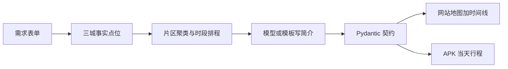
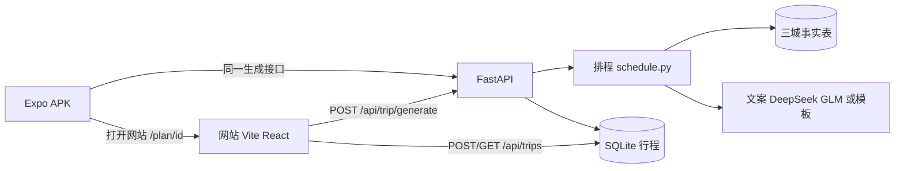
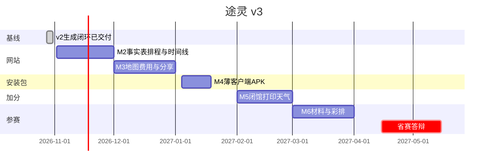

# 途灵 TripGenie · 项目执行计划（v3）

> 怎么把网页和手机跑起来，以仓库根目录的 README 为准。当前网页覆盖生成、打开行程、社区分享/导入和「我的」；Expo 已能连同一后端做轻量规划，并能打开某一天。下文仍是 v3 排程规格，不是当前界面的完成清单。
>
> 2026-10-30 修订。在 v2 已跑通的生成闭环上，把下一阶段收成可开工的规格。
> 双目标不变：① 简历上的项目经历；② 4C 中国大学生计算机设计大赛「人工智能应用」赛道参赛作品。
> 已确认约束：独立开发，每周约 20 小时；2026-10-28 启动；2027 年省赛（4–5 月）。
> 产品形态：网站是规划主界面，Android APK 是可安装的当天查看端。两端吃同一份行程 JSON。

## 已交付基线（v2 founding slice）

v2 计划的 T1–T8 已完成，本文件不推翻这些代码，只改它们上面的产品规格。

**已落地** — FastAPI 后端（行程 JSON 契约 + Pydantic 校验 + DeepSeek/GLM/Mock + `POST /api/trip/generate` + 失败重试与 mock 降级）与 Expo + TypeScript 移动端骨架（需求表单、三方案切换、时间线、加载/错误/降级态）。Mock 能按请求参数生成杭州/成都/西安及通用模板行程。分支 `feat/mvp`，提交范围 `29150f2..a00703d`。

**当时的验证** — `server/.venv/Scripts/python.exe -m pytest -q` → 31 passed（契约 12 + mock golden 12 + API 4 + 降级/风格/预算 7）；`mobile: npx tsc --noEmit` → exit 0。金标「杭州 3 天 1500 元 3 人 亲子+美食 style=all」能出 3 套方案。地图仍是占位组件。

**本次修订未改代码。** 上述测试结果是 v2 记录，实现 v3 契约时要按新验收重跑，不能把 31 passed 当成 v3 已通过。

## [S1] Problem

v2 把「输入 → 结构化行程 → 三方案时间线」跑通了，也写清了砍线和参赛材料。它还没回答三件下一阶段必须先定的事：

1. **用户真正缺的那一层没被占住。** 小红书、抖音、马蜂窝负责「想去哪」，笔记散、容易过期，排不进同一天。携程、飞猪、美团负责订票订房，学生作品补不上库存和支付。中间缺的是：把想去的点排成地理上走得通、时间和预算对得上、能在电脑上对比并在手机上查看的行程。
2. **现有生成方式还站在套壳一侧。** 同类 AI 行程常见的问题是地点靠编、同一天南北来回、三套方案只是换语气、费用被按比例凑到预算附近。当前 Mock 已有三城真实坐标（`server/app/llm/mock_engine.py`），选点顺序不按片区，费用仍按风格比例去贴预算。继续加 Chroma 自由检索或 ReAct，演示和实用性都更脆。
3. **双端容量装不下 v2 的后半段。** 网站和 APK 都要。原定 12 月 31 日「地图 + APK」一起冻结，再叠加 RAG、Agent、多模态，独立开发的 20 小时/周会在省赛前散掉。

v3 要交付的是一份能直接开工的规格：市场定位、事实点位加地理排程、契约增量、网站信息架构、APK 边界、新的冻结日和砍线。

## [S2] Design

### [S2.1] 定位与预算语义

目标用户：规划国内城市 1–5 日自由行的学生和年轻同行人。选择发生在电脑上，当天查看发生在手机上。演示城市继续用杭州、成都、西安。其他城市可以出行程，点位标记为估算。

预算是这一程的总预算，界面写明人数。费用拆成门票、餐饮、市内交通。住宿默认不计入：`budget_includes_hotel` 默认 `false`。打开后才加入住宿估算，并在费用里单独一行。这样「1500 元、3 人、3 天」表示三人这一程的门票、吃饭和市内交通，而不是被硬凑成含住宿的整趟账单。

三方案是三种排程目标，卡片上比较四个数：

| 方案 | 目标 | 卡片上要看出的差别 |
|---|---|---|
| 紧凑 compact | 片区内多打卡 | 站点数更高 |
| 松弛 relaxed | 少点、单点停留更久 | 站点数更低，单点停留更长 |
| 省钱 economy | 优先零门票，片区规则同样生效 | 门票合计更低 |

四个数：站点数、市内移动分钟、门票合计、步行衔接占比。三套方案都要地理上走得通。

### [S2.2] 生成流水线

模型不再负责编地点和凑金额。生成是固定流水线，Mock 与真实文案走同一条排程。



1. **事实表。** 点位名称、坐标、片区、标签、建议停留、门票单价、可选闭馆星期、来源，来自目录。实现时从 Mock 元组提升为 `server/app/data/catalog/` 下按城市分的 JSON，由加载器读入。
2. **排程。** `server/app/services/schedule.py` 按片区、时段、必去和风格组一天的顺序，并算出交通衔接与费用。同一天的景点与用餐落在同一个片区。杭州不把西湖、西溪、运河排进同一个上午。远郊点（杭州西溪、成都熊猫基地、西安兵马俑）单独占半天或一天。
3. **文案。** 有 DeepSeek 或智谱 key 时，只根据已排好的骨架写 `summary`、`route_rationale`、`description`、`tips`。无 key、超时或 JSON 修复一次仍失败时，使用目录里的简介模板。点位和金额不因文案失败而改道。
4. **契约。** Pydantic 校验通过后才返回。前端只渲染契约里的字段。

事实状态：目录中的点为 `sourced`；目录外的通用模板点为 `estimated`。闭馆字段 11 月入库，闭馆提示的界面放在 2 月（见 [S2.9]）。

**目录验收（三城都要达到，缺的在提升元组时补点）：**

- 每城至少 3 个片区、至少 10 个点。
- 至少一个片区有不少于 5 个点，供紧凑方案排满一天。
- 全城至少 4 个零门票点。
- 杭州西溪、成都熊猫基地、西安兵马俑标为远郊片区。
- 陕西历史博物馆 `closed_weekdays` 含周一。

**排程规则（实现按这些数写测试，避免再议）：**

- 一天内的 `attraction` 与 `meal` 共用一个片区 id。远郊片区当天不混入城区点。
- 同一片区内：直线距离小于 1.2 km 为步行，费用 0，时长按 4.5 km/h；否则为市内公共交通，另加 15 分钟，速度按 25 km/h，费用每人 4 元。远郊片区当天的进城段和出城段时长至少 60 分钟，费用每人 40 元，不使用市内单价。
- 当天从 09:00 起排。起点是该片区目录中的第一个点，之后每次选尚未安排、距离当前点最近的点。项目不少于 3 个时，11:30–13:30 之间安排一餐。片区里有餐饮点就用该点；没有则插入一条 `estimated` 的「片区内用餐」，坐标沿用上一个点，时长 60 分钟，费用按餐标。
- 紧凑：目标每天 4–6 项，停留按目录时长的 0.8 倍、下限 45 分钟。松弛：每天 2–4 项，单点停留至少 90 分钟。省钱：优先 `ticket_price = 0`，门票在门票、餐饮、交通三者中最低。
- 某片区点数不够风格目标时，保持同区，并给出 `style_rule` 警告。杭州、成都、西安的金标请求不应出现 `style_rule`；点数不够就补目录，不跨区硬凑。
- 必去最多 5 个地名，先按名称匹配目录。匹配到的点钉进它所在片区的某一天，再填满当天。匹配不到的名字进入警告 `must_visit_unmatched`，行程里不出现虚构点。

**费用规则：**

- 门票 = 各景点 `ticket_price × people`。餐饮 = 餐次 × 每人餐标 × 人数（省钱 35 元、默认 50 元、松弛 70 元），标记为估算。
- 市内交通按上面的衔接公式加总。
- `budget_includes_hotel = false` 时住宿为 0，界面说明「住宿未计入」。为 `true` 时按城给一个估算房价（杭州 300、成都 260、西安 240，元/间夜），间数按每间 2 人向上取整；天数不少于 2 时夜数为 `days - 1`，一天往返时夜数为 0。住宿整行标记为估算。
- `cost_breakdown` 与明细之和一致。与 `budget_total` 的比较范围是「已计入的那些项」。偏差大于 20% 时警告 `over_budget` 或 `under_budget`。禁止把各项按比例改到预算的 95% 附近。

有高德 Web 服务 key 时，12 月可以用路径规划结果替换直线距离估算；没有 key 或请求失败时保持上述公式，保证 Mock 与断网演示仍可排程。

### [S2.3] 关键技术决策

| # | 决策点 | 选择 | 理由 | 备选 |
|---|---|---|---|---|
| A1 | 规划端 | **Vite + React + TypeScript**，新目录 `web/` | 时间线与地图并排；高德 JS API 在浏览器里直接用 | Next.js。规划工具不需要服务端渲染 |
| A2 | 安装包 | **继续 Expo（prebuild）+ TypeScript** | 参赛要可安装 Android 包；当天列表用原生页 | 只做手机网页会缺 APK |
| A3 | 地图 | **网站接高德 JS API**；APK 打开网站工作台 | 地图只做一次，避开 Windows 上的 RN 原生地图构建 | 天地图 JS；APK 内再嵌一套原生 SDK |
| A4 | 模型 | **DeepSeek-V3 只写文案**；智谱 GLM 为备选 | JSON 稳、便宜；事实已在目录里 | 整份行程交给模型生成 |
| A5 | 排程 | **服务端确定性排程** | 三方案差别可测试，断网可演示 | ReAct 多工具链 |
| A6 | 知识 | **三城分区事实表** | 坐标、门票、停留、闭馆可维护、可引用 | Chroma + embedding 的自由检索 |
| A7 | 保存 | **SQLite 只存行程 JSON**，无用户表 | 分享链接需要 id；演示仍跑在本机 | 账号体系 + PostgreSQL |
| A8 | 契约 | **Pydantic 为源**，移动端与网站的 TS 类型手工同步 | 沿用已有双端习惯，再加网站一端 | 从 JSON Schema 生成 TS |
| A9 | 演示 | 本机 uvicorn + 同一排程的 Mock + 预录视频 + 已安装 APK | 学生预算与现场稳定性 | 必须上云才能演示 |
| A10 | APK 构建 | 本机 `gradlew assembleRelease` | 参赛交付可安装包 | EAS Build 免费额度，作备用 |

### [S2.4] 行程 JSON 契约（v3 增量）

后端 `server/app/schemas/trip.py` 仍是唯一事实源。同步改 `mobile/src/types/trip.ts` 与日后的 `web/src/types/trip.ts`。三处不一致视为未完成。

v2 已有字段保留：`trip_id`、`city`、`days`、`people`、`budget_total`、`style`、`preferences`、`summary`、`itinerary`、`cost_breakdown`，以及点位上的时间、类型、标题、坐标、时长、费用、简介、贴士、下一段交通、来源。

```json
{
  "city": "杭州",
  "days": 3,
  "people": 3,
  "budget_total": 1500,
  "style": "compact",
  "preferences": ["亲子", "美食"],
  "date_start": "2026-11-02",
  "must_visit": ["灵隐寺"],
  "budget_includes_hotel": false,
  "summary": "一句话行程概述",
  "route_rationale": "三天分别留在西湖、灵隐与河坊，西溪单独一天。",
  "metrics": {
    "stop_count": 12,
    "transit_min": 140,
    "ticket_total": 360,
    "walk_ratio": 0.45
  },
  "itinerary": [
    {
      "day": 1,
      "zone": "西湖",
      "theme": "西湖片区",
      "items": [
        {
          "time_start": "09:00",
          "time_end": "10:30",
          "type": "attraction",
          "title": "断桥残雪",
          "poi": { "name": "断桥残雪", "lat": 30.2593, "lng": 120.1477, "adcode": "330106" },
          "duration_min": 90,
          "cost_estimate": 0,
          "ticket_price": 0,
          "fact_status": "sourced",
          "closed_weekdays": [],
          "description": "景点介绍",
          "tips": "建议早去",
          "transport_to_next": { "mode": "walk", "duration_min": 15, "note": "沿白堤步行" },
          "sources": [{ "title": "杭州市文化广电旅游局", "url": "https://..." }]
        }
      ]
    }
  ],
  "cost_breakdown": { "transport": 80, "food": 450, "tickets": 360, "hotel": 0, "other": 0 }
}
```

请求增量（`POST /api/trip/generate`）：

| 字段 | 规则 |
|---|---|
| `date_start` | 可选，`YYYY-MM-DD`。不填则不做闭馆判断 |
| `must_visit` | 可选，最多 5 个非空字符串 |
| `budget_includes_hotel` | 布尔，默认 `false` |
| `style` | 仍为 `compact` / `relaxed` / `economy` / `all` |

`date_start`、`must_visit`、`budget_includes_hotel` 写入返回的 `Trip`，分享页和 APK 才能显示预算口径、出发日和必去名单。未匹配的必去只出现在警告里。

响应增量：

| 位置 | 字段 | 规则 |
|---|---|---|
| 方案 | `metrics.stop_count` | 全部天的项目数之和 |
| 方案 | `metrics.transit_min` | 全部 `transport_to_next.duration_min` 之和 |
| 方案 | `metrics.ticket_total` | 与 `cost_breakdown.tickets` 一致 |
| 方案 | `metrics.walk_ratio` | 步行衔接数 / 有衔接的项目数，无衔接时为 0 |
| 方案 | `route_rationale` | 一句话，说明每天留在哪个片区 |
| 每天 | `zone` | 片区名，非空 |
| 点位 | `fact_status` | `sourced` 或 `estimated` |
| 点位 | `ticket_price` | 每人门票，可选；景点缺省时按 0 |
| 点位 | `closed_weekdays` | 0–6，周一为 0；可为空数组 |

结构校验继续有效：每天 2–6 项、起止时间合法、时段重叠容差 5 分钟、天数连续、偏好标签至少一半能在文案里对上。风格未达标时出 `style_rule` 警告，阈值与排程目标一致：紧凑为某天少于 4 项；松弛为某天多于 4 项或单点停留少于 90 分钟；省钱为门票不是门票、餐饮、交通中的最低项，或全程没有零门票点。警告不改写已经排好的行程。

保存接口（12 月，无账号）：

- `POST /api/trips`，正文为一份 `Trip` JSON，返回 `{ "id": "..." }`。
- `GET /api/trips/{id}` 返回该 JSON。未知 id 为 404。
- SQLite 文件 `server/data/trips.sqlite`，表 `trips(id, payload, created_at)`。该文件加入 `.gitignore`。

### [S2.5] 架构与数据流



11 月先接通事实表、排程、文案和网站的对比与时间线。SQLite 与高德在 12 月接上。APK 在 1 月对齐契约。

### [S2.6] 网站信息架构

`web/` 使用 Vite + React + TypeScript。中文界面。桌面宽度不小于 960px 时，工作台左侧时间线、右侧地图。窄于 960px 时地图折到时间线下面，底部固定「下一站」：若 `date_start` 算出来今天落在某天，显示该天的下一站，否则显示当前所选日的第一项。

| 路由 | 页面 | 行为 |
|---|---|---|
| `/` | 表单与三方案对比 | 城市、天数（1–5，与短途定位一致；生成接口仍接受 1–7）、总预算、人数、偏好标签、风格、可选出发日期、最多 5 个必去、住宿是否计入。生成后在同页展示三张卡，每张卡四个数加一句路线理由 |
| `/plan/:id` | 工作台 | 按天切换的时间线、地图打点与顺序连线、费用拆分、警告、来源。从对比卡进入时先 `POST /api/trips` 再跳转 |
| `/share/:id` | 只读分享 | 同一份行程，无表单、无再生成。供同行打开，也供手机演示 |

地图用高德 JS API 画已保存的坐标与顺序。断网或瓦片失败时，时间线、四个数和点位列表仍在，地图区域说明「坐标已就绪，地图瓦片需要网络」。

必须做出的界面状态：加载中、表单或 422 校验错误、`engine: mock` 时的「演示引擎」提示、接口失败、零方案、预算偏差、必去未匹配。警告用可读中文，保留机器可读的警告码前缀（`over_budget`、`under_budget`、`style_rule`、`must_visit_unmatched`）。

预算输入的标签随开关变化：「总预算（N 人，不含住宿）」或「总预算（N 人，含住宿估算）」。

### [S2.7] APK 边界

`mobile/` 继续用 Expo。它是薄客户端，不重做一套地图。

主路径：表单、三方案的四个数、按天时间线、加载/错误/降级提示。地图按钮打开网站工作台（WebView 或系统浏览器，实现时二选一，默认系统浏览器以降低打包风险；WebView 仅在浏览器跳转演示不顺时再加）。12 月网站地图若未完成，1 月 APK 仍交付时间线，地图按钮可以隐藏。网站地图本身不降级成永久占位。

当天查看：默认第 1 天；填了 `date_start` 且今天落在行程内时打开对应那一天。

现有 `MapPlaceholder` 在 APK 对齐契约时换成「在地图中查看」或隐藏，不再承诺 RN 内嵌高德。

### [S2.8] 功能分层

| 层 | 内容 | 冻结时间 | 做不完时 |
|---|---|---|---|
| **P0** | 三城事实表与同区排程；契约 v3；网站表单、四指标对比、时间线、状态提示；网站高德打点连线；SQLite 分享与只读页；Mock 走同一排程；APK 可安装并完成时间线与降级提示 | 网站 2026-12-31；APK 2027-01-18 | 按 [S2.10] 砍分享或 APK 地图，保留网站地图、四指标、三城、降级提示、可安装时间线 |
| **P1** | 出发日期下的闭馆提示；分享页打印样式；生成前一次天气查询并写进当天说明；网站上调整顺序 | 2027-02-28 | 拖拽最先停；打印与天气可整项不做 |
| **赛后** | Chroma/bge 自由检索、ReAct、拍照识景、语音、账号、多城联游、iOS、社区、支付 | — | 写进路线图，不排进省赛前工时 |

天气若做：生成前请求一次，把一句说明放进当天 `theme` 或单独的当天备注。失败则跳过。不进入多步工具循环。

### [S2.9] 里程碑（自 2026-10-30，每周约 20 小时）



| 里程碑 | 日期 | 工时 | 交付物 | 验收（达不到不算完成） |
|---|---|---|---|---|
| **M2 事实、排程、网站时间线** | 11.02–11.30 | 80h | 三城目录、排程、契约 v3 与测试、`web/` 表单、对比卡、时间线与状态 | 浏览器完成「杭州 3 天、1500 元、3 人、亲子+美食」：三套方案可切换；每一天一个片区；四指标可见且门票与明细一致；住宿默认 0；费用不是按比例贴到预算的 95%；必去命中与未命中有测试。地图可以仍是列表 |
| **M3 地图、费用、分享** | 12.01–12.31 | 80h | 高德打点连线、费用与警告展示、`POST/GET /api/trips`、只读分享页 | **12.31 冻结网站**：桌面走完表单 → 对比 → 工作台地图 → 复制分享链接 → 只读页。断网时时间线仍在。窄屏有「下一站」 |
| **M4 APK** | 01.04–01.18 | 40h | Expo 对齐契约 v3，release APK | **01.18 冻结安装包**：真机安装后走完表单 → 四指标 → 时间线 → 降级提示。地图能打开网站，或在网站地图未就绪时隐藏入口 |
| **M5 加分** | 02.01–02.28 | 0–48h | 闭馆提示、打印样式、一次天气；拖拽改顺序可选 | 单项可独立验收。拖拽做不完则取消。2.28 后不再开新功能 |
| **M6 参赛材料** | 03.01–03.31 | 72h | 说明文档、演示视频、答辩 PPT、彩排、报名材料 | 3.10 说明文档初稿；3.20 视频成片；3.25 PPT 定稿；3.31 提交材料；彩排至少 3 次，其中 1 次断网 |

11–12 月按每周 20 小时排满，缓冲在 M5：加分项可以整月不做。每周日晚 30 分钟对照上表看延期。延期超过 5 天就执行 [S2.10]，不临时加功能。

11 月内部顺序：目录 JSON → 排程与费用测试 → 生成服务改为「先排程、后文案」→ 网站骨架接到现有 API。高德 key 未下发前不阻塞 11 月验收。

### [S2.10] 砍线规则

| 触发 | 条件 | 执行 |
|---|---|---|
| 12.31 | 网站地图未完成 | APK 不做、不展示地图。1 月只交付时间线安装包。网站继续把地图补完后再开 APK 地图入口 |
| 12.31 | 分享接口未完成 | 演示使用本机预置的一份行程 JSON 打开工作台。分享页推迟到 M5，M5 仍完不成则答辩用预置页 |
| 01.18 | APK 装不上 | 手机用浏览器打开网站窄屏页完成「当天查看」演示，并在 48 小时内再打一次 release。安装包目标不取消 |
| 03.10 | 说明文档初稿未成，或已到初稿日 | 停止闭馆提示、打印、天气、拖拽中一切未完成项 |
| 任何时点 | 真实文案引擎连续 2 天不可用，或文案 JSON 失败率超过 10% | 暂停新界面，修文案提示词。排程与 Mock 演示保持可走完 |
| 任何时点 | 彩排失败 1 次 | 48 小时内再彩排。连续两次失败则全程改走 Mock 脚本加预录视频 |

以下不砍：杭州/成都/西安、四指标对比、同区排程、降级提示、可安装 APK 的时间线路径、网站地图（只允许推迟 APK 里的地图，不允许把网站地图从 P0 去掉）。

### [S2.11] 账号与资源

| 事项 | 途径 | 建议完成 | 说明 |
|---|---|---|---|
| DeepSeek API key | platform.deepseek.com，充值约 ¥20 起 | 11.02 | 只用于文案。没有 key 时 11 月仍可验收 |
| 智谱 GLM key | open.bigmodel.cn | 11.02 | 文案备选 |
| 高德开放平台 | lbs.amap.com 实名应用 | 11.08 | 12 月地图要用 |
| 高德 JS API key 与 Web 服务 key | 同上，分开申请 | 11.15 | JS 给浏览器，Web 服务给可选的路径替换 |
| 天地图 key | 天地图开发者平台 | 12 月前 | 高德审核不通过时的地图备选 |
| Android 签名 keystore | 本机 keytool | 01.04 前 | 打 release 前必须有 |
| 指导老师 | 学院 | 11 月内 | 多数学校报名需要 |
| 4C 通知 | 大赛官网与学院 | 12.31、02.28 各核对一次 | 字数、时长、提交格式以当年通知为准 |
| Git 仓库 | 已有本地仓库 | 已有 | 需要远程时再推；不因仓库托管阻塞功能 |

### [S2.12] 成本

| 项目 | 估算 | 说明 |
|---|---|---|
| DeepSeek 文案 | ¥30–80 | 调用比「整份行程都由模型写」短 |
| 高德 | ¥0 | 个人开发者额度内 |
| 本机演示 | ¥0 | uvicorn + 手机局域网或本机浏览器 |
| 备用云主机 | ¥0–60 | 只有评委必须远程访问时才开学生机 |
| **合计** | **≤ ¥300** | 无订阅型依赖 |

### [S2.13] 质量

- **排程测试：** 三城金标各跑 `style=all`。断言同日同区、远郊不与城区混排、四指标与明细一致、默认住宿为 0、总费用允许偏离预算且不得被改写成预算的固定比例。必去命中钉在对应片区；不存在的地名产生 `must_visit_unmatched` 且标题中不出现该字符串。
- **契约测试：** v3 新字段缺省、非法 `fact_status`、超过 5 个必去、日期格式错误。
- **API：** 生成成功、文案失败时仍返回排程结果且 `engine` 为 `mock`、保存后能按 id 取回、未知 id 为 404。
- **网站：** `npx tsc --noEmit` 无错误。每次发版手走：表单 → 三卡 → 工作台 → 分享只读 → 加载、错误、演示引擎、预算警告、必去未匹配。桌面与窄屏各一次。
- **移动端：** `tsc --noEmit` 无错误。手走表单 → 四指标 → 时间线 → 降级提示。
- **契约变更：** 先改 Pydantic，再改两份 `trip.ts`，后端测试与两端 `tsc` 都通过。
- **演示：** 每周至少一次 Mock 全路径。提交前彩排不少于 3 次，含 1 次断网。断网标准是时间线、指标和演示引擎提示仍可用。

### [S2.14] 参赛材料（4C 人工智能应用）

篇幅按往年常见规格预留，以 2027 年官方通知为准。

| 材料 | 规格 | 结构 |
|---|---|---|
| 说明文档 | 约 3000 字加图 | 痛点（灵感与交易之间的规划缺口）→ 流水线架构 → 事实表与排程 → 文案分离与 `sourced`/`estimated` → 网站工作台与 APK → 创新点 → 应用价值 → 测试与截图 |
| 演示视频 | 3–5 分钟 | 见 [S2.15]。片头有作品名与学校，全程配音，最后 20 秒收在流水线与四个对比指标 |
| 答辩 PPT | 10–15 页 | 封面、痛点、架构、排程、契约与事实标记、双端界面、创新点、路线图、致谢。每页一个结论式标题 |
| 可运行成果 | 网站本机运行说明 + Android APK | README 写明 Mock 下一分钟可走完网站，以及 APK 的安装方式 |
| 源码 | Git 仓库 | README 含简介、架构、启动步骤、目录说明 |

说明文档的实现章写已经落地的流水线。自由检索和多步工具调用放在路线图，不写成已完成章节。

### [S2.15] 演示脚本与兜底

现场约 4 分钟。笔记本打开网站，手机打开同一分享链接或 APK 的当天列表。

| 时间 | 内容 | 画面 |
|---|---|---|
| 0:00–0:30 | 攻略散落，排到同一天就会来回折返 | 一页痛点 |
| 0:30–1:20 | 输入杭州、3 天、1500 元、3 人、亲子 | 三张卡上的四个数 |
| 1:20–2:20 | 打开松弛方案的工作台，点一天看片区与来源 | 时间线 + 地图 |
| 2:20–3:10 | 手机打开分享页或 APK，停在当天行程 | 窄屏「下一站」或 APK 时间线 |
| 3:10–3:40 | 指出一个 `sourced` 点位和费用未按比例改写 | 来源与费用拆分 |
| 3:40–4:00 | 用流水线收束：目录排程，模型只写理由 | 架构图 |

兜底三件套：

1. **Mock 排程：** 无 key、断网时仍能生成三套合法行程，前端显示「演示引擎」。
2. **预录视频：** 4 分钟 MP4，U 盘里有一份。
3. **已安装 APK：** 备用机事先装好，现场不临时下载。另备浏览器书签指向本机分享页。

### [S2.16] 简历表述（实现并核对后再写上简历）

- 独立设计并实现旅游行程规划「途灵」（Vite/React 网站、Expo 安装包、FastAPI）。用城市事实点位和片区排程生成可渲染行程，大模型只写路线理由与贴士；紧凑、松弛、省钱三套方案用站点数、移动时间、门票和步行占比对比。
- 行程 JSON 经 Pydantic 校验。点位带来源，并标为目录事实或估算。文案引擎不可用时，同一套排程仍可离线演示。
- 网站提供时间线与地图对照及只读分享；Android APK 提供可安装的当天行程。
- 交付参赛材料（可运行网站、APK、演示视频、说明文档）。入围省赛之后再加赛果，不提前写。

### [S2.17] 赛后路线

省赛提交前不立项、不占 [S2.9] 的工时：

| 顺序 | 内容 |
|---|---|
| 1 | 自由检索（向量库与开放语料），接在事实表之外作补充说明 |
| 2 | 多步工具调用（重新规划、改一天、问「下雨怎么办」） |
| 3 | 拍照识景、语音输入与播报 |
| 4 | 账号、历史与多设备 |
| 5 | 多城市联程、iOS、社区与支付 |

## [S3] Out of Scope

以下不属于 v3 省赛前的交付：

- Chroma、bge、百科语料自由检索，以及 ReAct / 多工具循环。
- 拍照识景、语音、账号、收藏云同步、社区、支付、多城联游、iOS 上架。
- 在 APK 内用原生地图 SDK 再做一套打点。
- 把住宿做成酒店搜索或可预订清单。住宿只是可选的估算行。
- 为了贴近预算而按比例改写门票、餐饮和交通。
- 4C 2027 年官方格式的最终文本（以 [S2.11] 的两次核对为准）。

## Tasks

v2 的 T1–T8（仓库骨架、契约、Mock、生成 API、移动端表单与时间线、README 演示路径、风格与降级测试）已完成，见文首基线。下面是 v3 的实现任务，本次只写入规格，不在修订文档时开工。

- [ ] T9: 三城事实表 — acceptance: `server/app/data/catalog/` 覆盖杭州、成都、西安，满足 [S2.2] 的片区数量、点数、零门票、远郊与陕历博周一闭馆；Mock 元组改为读这套目录 (covers: S2.2, S2.3)
- [ ] T10: 排程与契约 v3 — acceptance: `schedule.py` 实现同区、远郊、费用与必去规则；`POST /api/trip/generate` 先排程后文案；pytest 覆盖 [S2.13] 的排程与契约用例；金标不再把总费用改写为预算的固定比例 (covers: S2.2, S2.4)
- [ ] T11: 网站表单、对比与时间线 — acceptance: `web/` 在 Vite 下 `tsc --noEmit` 通过；杭州金标在浏览器可切换三方案并看到四个数与按天时间线；加载、错误、演示引擎、预算偏差、必去未匹配五种状态可见 (covers: S2.6, S2.9)
- [ ] T12: 网站地图 — acceptance: 工作台用高德 JS 按顺序打点连线；瓦片失败时时间线仍可用；窄屏地图在时间线下方且有「下一站」 (covers: S2.6, S2.10)
- [ ] T13: 分享 — acceptance: `POST /api/trips` 与 `GET /api/trips/{id}` 可用；`/share/:id` 只读；sqlite 文件被 git 忽略 (covers: S2.4, S2.5)
- [ ] T14: APK — acceptance: 移动端类型与 v3 契约一致；release APK 在真机走完表单、四指标、时间线与降级提示；地图入口打开网站或在地图未就绪时隐藏 (covers: S2.7, S2.9)
- [ ] T15: 二月加分（可整项取消） — acceptance: 有出发日期时对 `closed_weekdays` 给出提示；分享页可打印；天气失败不影响生成。拖拽改顺序未完成则从范围删除 (covers: S2.8, S2.10)
- [ ] T16: 参赛材料 — acceptance: 说明文档、视频、PPT 按 [S2.14] 与 [S2.15] 的日期完成；创新章描述的是事实表与排程，而不是未做的检索与多步工具调用 (covers: S2.14, S2.16)
